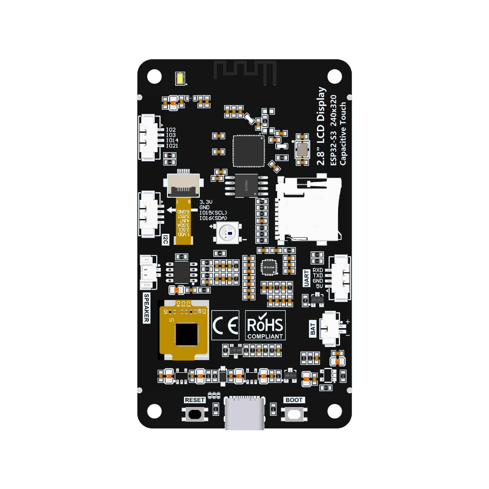

# Home Heritage Companion

Firmware and experimentation project for the **LCDWiki ES3C28P**, an ESP32-S3 board with a 2.8-inch capacitive touchscreen and onboard audio hardware.

> **Project status:** early-stage proof of concept. The firmware has software paths for the dashboard and connected APIs, but hardware behavior depends on verifying the exact board revision, pin mapping, display/touch setup, audio codec, and storage configuration. A successful compile does not by itself confirm that every peripheral works on the physical board.

## Board overview

The project includes photos of the board's front and back, plus a pin-interface schematic in the `thum/` directory.

### Front of the board


### Back of the board



### Pin-interface schematic


For the vendor's product photos and documentation, see the [LCDWiki 2.8-inch ESP32-S3 Display — Product Picture](https://www.lcdwiki.com/2.8inch_ESP32-S3_Display#Product_Picture).

For background on using audio-capable LCD boards with Arduino Audio Tools, see the [Arduino Audio Tools wiki: LCD Boards with Audio](https://github.com/pschatzmann/arduino-audio-tools/wiki/LCD-Boards-with-Audio).

## Features in the current firmware

- **LVGL touchscreen UI** with Outdoor / OurHeritage, Music, Indoor / Mochi, and Settings pages.
- **Wi-Fi setup** with on-screen SSID/password entry, local credential storage using ESP32 Preferences, and reconnect attempts.
- **Outdoor Intelligence proof of concept** using Open-Meteo Weather, Air Quality and Flood data, USGS earthquake information, NASA POWER, and NASA FIRMS VIIRS near-real-time hotspot records around a fixed Jakarta demo location.
- **Rule-based recommendations** based on available indicators. Unavailable API responses should be displayed as unavailable rather than treated as real measurements.
- **Music player** intended to play MP3 files from the `/Music` directory on microSD, with play/pause, previous/next, volume and shuffle controls. Audio behavior and track auto-advance still need to be confirmed on the target hardware.
- **Serial diagnostics** at 115200 baud.

The Indoor / Mochi page may show labelled demo values until the LoRa wiring is verified. Live telemetry should only be treated as real after a valid packet has been received.

## Hardware reference

| Item | Current reference |
|---|---|
| Board | LCDWiki ES3C28P, ESP32-S3 |
| Display | ILI9341V, 240 × 320 SPI (verify exact board/revision) |
| Touch | FT6336G capacitive touch over I²C (verify against the board documentation) |
| Audio | ES8311/audio amplifier path; verify codec and amplifier configuration |
| Memory | Vendor documentation lists 16 MB flash and 8 MB OPI PSRAM; verify the exact revision |

### References

- [LCDWiki product page and documentation](https://www.lcdwiki.com/2.8inch_ESP32-S3_Display)
- [LCDWiki Product Picture](https://www.lcdwiki.com/2.8inch_ESP32-S3_Display#Product_Picture)
- [LCDWiki Arduino demo instructions (PDF)](https://www.lcdwiki.com/res/ES3C28P/2.8inch_ES3C28P_ES3N28P_arduino_Demo_Instructions.pdf)
- [ES3C28P board-support reference](https://github.com/ngttai/esp32_s3_es3c28p)
- [Arduino Audio Tools — LCD Boards with Audio](https://github.com/pschatzmann/arduino-audio-tools/wiki/LCD-Boards-with-Audio)

**Important:** Confirm display/touch GPIOs, board revision, flash/PSRAM configuration, audio wiring and microSD behavior using the official board demo and schematic before flashing or relying on the device.

## Build with PlatformIO

1. Install Visual Studio Code and the PlatformIO IDE extension.
2. Open this repository folder in VS Code.
3. In the PlatformIO terminal, run:

   ```powershell
   pio run
   ```

4. Resolve compiler errors before uploading firmware.
5. Before flashing, validate the exact board revision and test the display, touch, audio codec, microSD and relevant GPIOs.

The configured PlatformIO environment is `es3c28p`. A successful build verifies compilation only; it is not a substitute for a physical-board test.

## NASA FIRMS API key configuration

The Outdoor Intelligence page can query NASA FIRMS VIIRS near-real-time hotspot records around the current demo coordinates. The key is intentionally excluded from the repository.

1. In the project, open the `include/` folder.
2. Create a new file named `config.h`, so the path is `include/config.h`.
3. Add the following line, replacing the placeholder with your own NASA FIRMS MAP key:

   ```cpp
   #pragma once
   #define HHC_FIRMS_MAP_KEY "YOUR_MAP_KEY"
   ```

4. Save the file and run `pio run`.

The repository's `.gitignore` excludes `include/config.h`. Keep the real key in that local file and **do not commit it**. A key compiled into ESP32 firmware may still be extracted from a firmware image or device; this setup prevents accidental publication in source control but does not make the key secret. For a distributed device, consider a server-side proxy with rate limiting. If a key has been exposed, revoke or replace it if the provider supports that.

Hotspot records are satellite detections, not a direct measurement of smoke and not confirmation of an emergency at the user's precise location. Interpret them alongside air-quality readings, wind context and official local advisories. This feature is not an official warning system.

## LoRa / Indoor-Mochi notes

LoRa UART support is intentionally disabled by default until the E220/E32 module wiring and available ESP32-S3 pins are verified. Only set `HHC_LORA_RX_PIN` and `HHC_LORA_TX_PIN` after checking the physical wiring.

The receiver foundation expects transparent UART mode and newline-delimited JSON. The current code does not configure the radio's frequency, channel, addressing, air data rate or E220/E32 mode pins. These settings must be matched between master and slave and must comply with local regulations.

See [docs/lora-protocol.md](docs/lora-protocol.md) for the packet schema and example.

## Known limitations

- Outdoor API queries currently use fixed Jakarta coordinates for a proof of concept; GPS/site selection and a persistent offline API cache are not yet ported.
- API availability depends on network access and each provider's service behavior.
- Audio depends on the ES8311/amplifier configuration and compatible microSD media; test playback and auto-next on the physical device.
- The exact display, touch, flash/PSRAM and GPIO settings must be verified against the board revision.
- This repository is separate from the OurHeritage web application and does not copy its source.
- Sensor readings should only be treated as live measurements when they come from valid telemetry.

## Roadmap

1. Verify board revision, display driver, touch orientation, flash/PSRAM and GPIO configuration.
2. Validate audio codec output, microSD mounting, track selection and end-of-track behavior.
3. Verify LoRa UART wiring and align packet/radio settings with the Mochi slave.
4. Extend OurHeritage content retrieval and offline caching.
5. Add telemetry history, thresholds and carefully scoped notifications.

## Safety

Use the board's documented power input and a suitably protected battery configuration. SGP30 eCO2/TVOC values are not a certified gas-leak detector or life-safety measurement. NASA FIRMS detections and other online data should not be treated as a substitute for official emergency alerts.
